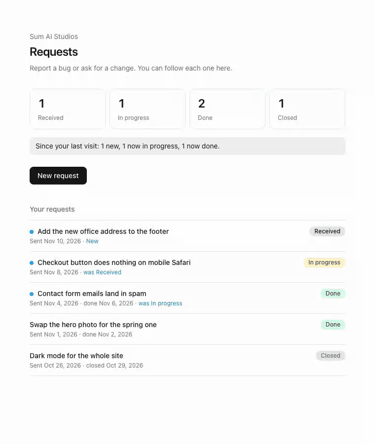

# Clientline

A private request page for each of your clients, with GitHub Issues as the backend.



Your client opens their link, says what they need, and follows its status. Each request becomes an issue in your repo. There is no database, no client accounts and nothing to host beyond one small Next.js app.

- **One link per client.** `/c/<key>`, no sign-up. A client sees only their own requests.
- **Requests are GitHub issues,** labelled `client:<name>`, so they land in the tracker you already use.
- **Status comes from the issue.** Open is *Received*, add an `in-progress` label for *In progress*, close it for *Done* (closing as "not planned" or as a duplicate shows *Closed*).
- **Your name, not ours.** Client pages show your name only.

## Deploy

[](https://vercel.com/new/clone?repository-url=https%3A%2F%2Fgithub.com%2Fsumaistudios%2Fclientline&env=GITHUB_TOKEN,GITHUB_REPO,FREELANCER_NAME,CLIENTS&envDescription=See%20the%20README%20for%20each%20setting)

Set four environment variables:

| Variable | Example | |
|---|---|---|
| `GITHUB_TOKEN` | `github_pat_…` | A [fine-grained token](https://github.com/settings/personal-access-tokens/new) with access to that one repo and **Issues: Read and write**. Nothing else. |
| `GITHUB_REPO` | `you/client-work` | Where requests are filed. |
| `FREELANCER_NAME` | `Ada Studio` | Shown at the top of every client page. |
| `CLIENTS` | `acme:Xk29fQp4mL,bloom:Tz81vNc3qW` | Each client's name (lowercase, used in the label) and the secret key in their link. |

Optional: `EXTRA_LABELS`, a comma-separated list of labels added to every request (for example `triage`).

Make each key long and random, for example `openssl rand -base64 12 | tr -d '/+='`. To revoke a link, change that client's key and redeploy.

Then send each client their link: `https://<your-deploy>/c/<their key>`.

## Try it

Run it with sample data, without a token or a repo: set `DEMO=1` (and nothing else) and open `/c/demo`. Requests you send in demo mode are shown back but not saved or sent anywhere.

## Run locally

```bash
cp .env.example .env.local   # fill it in
npm install
npm run dev
```

## What a client can and cannot do

- They can create issues in your repo with the label for their name, and read the title and status of issues with that label.
- They never see issue bodies, comments, other clients' requests or anything else in the repo.
- Their text is put in a code block in the issue, so it cannot @mention people or add markdown to your tracker.
- Pages are marked noindex and send no referrer, so links do not leak to other sites.

## Fix them automatically

Clientline only collects the requests. If you want each one investigated, fixed on its own branch, independently verified and opened as a pull request for you to review, that is what [Keanu](https://www.heykeanu.app) does: add `keanu` to `EXTRA_LABELS` and Keanu picks up every new request.

## License

MIT
